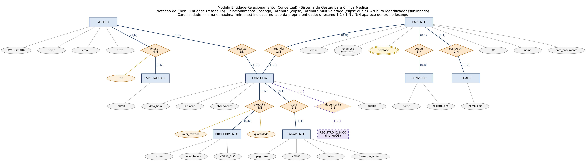
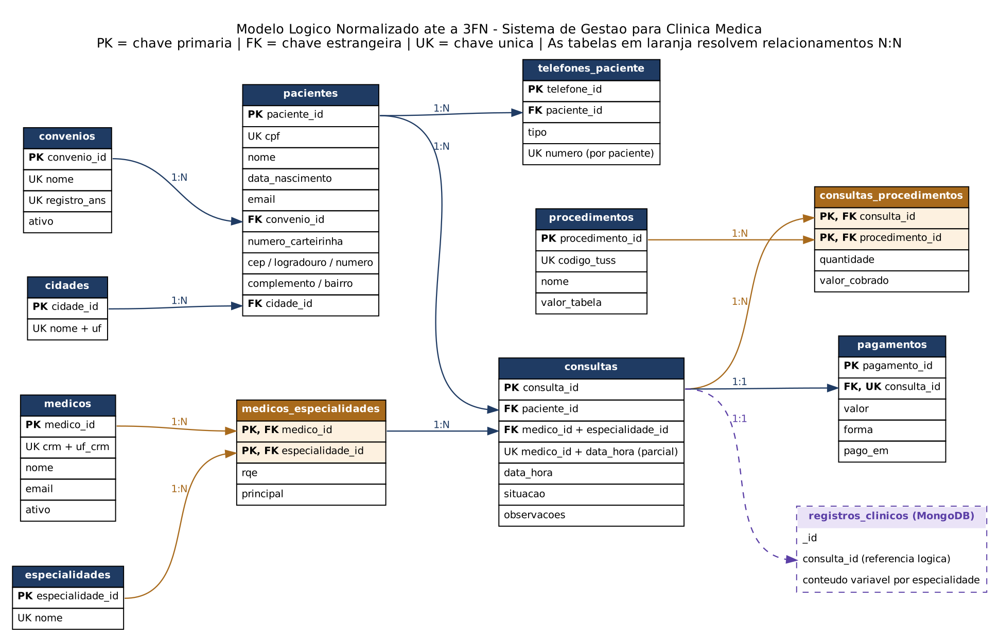

# Projeto Final de Banco de Dados — Sistema de Gestão para Clínica Médica

Entregável da Semana 15 — Modelagem Conceitual, Modelagem Lógica e Normalização.

Este repositório dá continuidade ao escopo definido na Semana 14. Aqui o projeto sai
do texto e vira modelo: o MER conceitual, a transição para o modelo lógico, a
aplicação das três primeiras formas normais, a definição explícita das chaves e o
script DDL executado no PostgreSQL.

---

## Sumário

- [1. Parte 1 — Modelagem Conceitual](#1-parte-1--modelagem-conceitual)
- [2. Parte 2 — Modelo Lógico, Normalização e Chaves](#2-parte-2--modelo-lógico-normalização-e-chaves)
- [3. Parte 3 — Execução, dados de teste e testes de integridade](#3-parte-3--execução-dados-de-teste-e-testes-de-integridade)
- [4. Desafio de Normalização — a tabela desnormalizada e suas anomalias](#4-desafio-de-normalização--a-tabela-desnormalizada-e-suas-anomalias)
- [5. Parte 4 — Reflexão](#5-parte-4--reflexão)
- [6. Estrutura do Repositório](#6-estrutura-do-repositório)
- [7. Como Executar](#7-como-executar)

---

## 1. Parte 1 — Modelagem Conceitual

O MER conceitual está documentado em [`docs/MER-conceitual.md`](docs/MER-conceitual.md),
com o diagrama em [PNG](docs/diagramas/mer-conceitual.png) e
[PDF](docs/diagramas/mer-conceitual.pdf).



### 1.1 Entidades identificadas

| Entidade | Papel no sistema |
| --- | --- |
| **PACIENTE** | Pessoa atendida pela clínica. |
| **MEDICO** | Profissional responsável pelo atendimento. |
| **CONSULTA** | Encontro entre paciente e médico em data e hora. Entidade central. |
| **PAGAMENTO** | Registro financeiro da consulta realizada. |
| **PROCEDIMENTO** | Item da tabela de serviços (consulta, exame, pequeno procedimento). |
| **ESPECIALIDADE** | Área de atuação médica. |
| **CONVENIO** | Operadora de plano de saúde do paciente. |
| **CIDADE** | Município do endereço do paciente. |
| **REGISTRO CLÍNICO** | Evolução clínica da consulta — lado NoSQL do projeto (MongoDB). |

### 1.2 Cardinalidades

| Relacionamento | Cardinalidade |
| --- | --- |
| PACIENTE *agenda* CONSULTA | 1:N |
| MEDICO *realiza* CONSULTA | 1:N |
| MEDICO *atua em* ESPECIALIDADE | **N:N** |
| CONSULTA *executa* PROCEDIMENTO | **N:N** |
| CONSULTA *gera* PAGAMENTO | 1:1 |
| PACIENTE *possui* CONVENIO | 1:N |
| PACIENTE *reside em* CIDADE | 1:N |
| CONSULTA *documenta* REGISTRO CLÍNICO | 1:1 |

Os dois relacionamentos N:N são o ponto de atenção da transição para o modelo lógico:
eles não existem lá e precisam virar tabelas associativas.

---

## 2. Parte 2 — Modelo Lógico, Normalização e Chaves

O modelo lógico completo está em [`docs/modelo-logico.md`](docs/modelo-logico.md) e o
passo a passo da normalização em [`docs/normalizacao.md`](docs/normalizacao.md).



### 2.1 Resumo da normalização

| Forma Normal | O que foi corrigido neste projeto |
| --- | --- |
| **1FN** — atributos atômicos | Telefones separados por vírgula viraram a tabela `telefones_paciente`; o endereço em texto corrido virou colunas (`cep`, `logradouro`, `numero`, `complemento`, `bairro`); listas de especialidades e de procedimentos viraram relacionamentos. |
| **2FN** — sem dependências parciais | Com a chave composta `(paciente, data_hora, procedimento)`, os dados do paciente dependiam só do paciente e os do procedimento só do procedimento. Decomposição em `pacientes`, `medicos`, `procedimentos`, `consultas` e `consultas_procedimentos`. |
| **3FN** — sem dependências transitivas | `CEP → cidade/UF` saiu para `cidades`; `convênio → registro ANS` saiu para `convenios`; a especialidade em texto livre virou `especialidades` + `medicos_especialidades`; e `valor_total`, por ser derivado, não é armazenado. |

### 2.2 Chaves primárias e estrangeiras

| Tabela | PK | FKs |
| --- | --- | --- |
| `cidades` | `cidade_id` | — |
| `convenios` | `convenio_id` | — |
| `pacientes` | `paciente_id` | `convenio_id`, `cidade_id` |
| `telefones_paciente` | `telefone_id` | `paciente_id` |
| `especialidades` | `especialidade_id` | — |
| `medicos` | `medico_id` | — |
| `medicos_especialidades` | **`(medico_id, especialidade_id)`** | `medico_id`, `especialidade_id` |
| `consultas` | `consulta_id` | `paciente_id`, `(medico_id, especialidade_id)` |
| `procedimentos` | `procedimento_id` | — |
| `consultas_procedimentos` | **`(consulta_id, procedimento_id)`** | `consulta_id`, `procedimento_id` |
| `pagamentos` | `pagamento_id` | `consulta_id` (único — materializa o 1:1) |

As duas tabelas em negrito são as associativas: a PK delas é a junção das duas chaves
estrangeiras, exatamente como exige a resolução de um relacionamento N:N.

### 2.3 Script DDL

[`database/01_ddl.sql`](database/01_ddl.sql) cria o banco, os tipos enumerados, as 11
tabelas, as constraints de `PRIMARY KEY`, `FOREIGN KEY`, `UNIQUE` e `CHECK`, os índices
de apoio e a view de faturamento.

---

## 3. Parte 3 — Execução, dados de teste e testes de integridade

Os três scripts foram executados no **PostgreSQL 16**. As saídas completas do terminal
estão em [`docs/evidencias-execucao.md`](docs/evidencias-execucao.md).

### 3.1 Dados de teste

[`database/02_insercao_teste.sql`](database/02_insercao_teste.sql) popula a cadeia
inteira de tabelas relacionadas — 3 cidades, 2 convênios, 4 especialidades, 4
procedimentos, 3 pacientes, 5 telefones, 2 médicos, 3 vínculos médico-especialidade, 3
consultas, 4 itens de procedimento e 2 pagamentos. A carga só completa se todas as FKs
estiverem corretas, porque cada inserção depende da anterior.

### 3.2 Bônus — violações de integridade

[`database/03_testes_integridade.sql`](database/03_testes_integridade.sql) executa oito
comandos que **devem falhar**, cada um isolado em `BEGIN ... ROLLBACK`:

| # | Tentativa | Erro retornado pelo PostgreSQL |
| --- | --- | --- |
| 1 | Consulta para um `paciente_id` inexistente | `violates foreign key constraint "fk_consultas_paciente"` |
| 2 | Repetir o par `(medico_id, especialidade_id)` | `duplicate key value violates unique constraint "pk_medicos_especialidades"` |
| 3 | Dois pacientes com o mesmo CPF | `duplicate key value violates unique constraint "uq_pacientes_cpf"` |
| 4 | Ortopedista atendendo como cardiologista | `violates foreign key constraint "fk_consultas_medico_especialidade"` |
| 5 | Apagar paciente que tem consultas | `violates foreign key constraint ... is still referenced` |
| 6 | Segundo pagamento para a mesma consulta | `duplicate key value violates unique constraint "uq_pagamentos_consulta"` |
| 7 | Pagamento com valor negativo | `violates check constraint "ck_pagamentos_valor_positivo"` |
| 8 | Dois agendamentos ativos no mesmo horário do médico | `duplicate key value violates unique constraint "uq_medico_horario"` |

Depois das oito tentativas, as contagens de registros permanecem inalteradas — nenhum
dado inválido entrou no banco.

---

## 4. Desafio de Normalização — a tabela desnormalizada e suas anomalias

Antes do sistema, a clínica controlava os atendimentos em **uma planilha só**, com uma
linha por atendimento e colunas como estas:

| cpf_paciente | nome_paciente | telefones | endereco_completo | convenio | registro_ans | crm_medico | nome_medico | especialidades_medico | data_hora | procedimentos | valor_total |
| --- | --- | --- | --- | --- | --- | --- | --- | --- | --- | --- | --- |
| 529.982.247-25 | Mariana Alves Rocha | (85) 98877-6655, (85) 3233-4455 | Av. Santos Dumont, 1800, Sala 4 - Aldeota - Fortaleza/CE | Unimed Ceará | 301001 | 14523-CE | Dra. Helena Castro | Cardiologia, Clínica Médica | 10/11/2026 09:00 | Consulta (250,00), ECG (90,00) | 340,00 |
| 529.982.247-25 | Mariana A. Rocha | (85) 98877-6655 | Av. Santos Dumont, 1800 - Aldeota - Fortaleza/CE | Unimed CE | 301001 | 14523-CE | Dra. Helena Castro | Cardiologia, Clínica Médica | 02/12/2026 10:00 | Consulta (250,00) | 250,00 |

Duas linhas bastam para mostrar o estrago: **o mesmo paciente aparece com dois nomes**
("Mariana Alves Rocha" e "Mariana A. Rocha") e **o mesmo convênio com dois nomes**
("Unimed Ceará" e "Unimed CE"). Ninguém digitou errado de propósito — é o que acontece
quando o mesmo dado precisa ser redigitado a cada atendimento.

### As três anomalias

- **Inserção:** não dá para cadastrar um convênio novo, um médico recém-contratado ou
  um procedimento da tabela TUSS sem inventar um atendimento. O dado só entra de
  carona em uma consulta.
- **Atualização:** a Unimed muda de razão social e o nome precisa ser corrigido em
  todas as linhas de todos os pacientes. Uma linha esquecida já deixa o banco
  afirmando duas coisas diferentes ao mesmo tempo.
- **Exclusão:** apagar o único atendimento de um paciente apaga junto o cadastro dele,
  os telefones e o endereço. Em clínica, isso é perda de prontuário.

### Como a 3FN resolveu

| Etapa | O que mudou |
| --- | --- |
| **1FN** | `telefones` virou a tabela `telefones_paciente` (uma linha por número) e `endereco_completo` virou colunas atômicas. Não existe mais lista dentro de célula. |
| **2FN** | Com a chave composta do atendimento, `nome_paciente` dependia só do CPF e `nome_procedimento` só do código TUSS — dependências parciais. Os dados foram para `pacientes` e `procedimentos`. |
| **3FN** | `registro_ans` dependia do convênio, não do paciente: saiu para `convenios`. Cidade e UF dependiam do CEP: saíram para `cidades`. `valor_total`, derivado dos procedimentos, deixou de ser armazenado e virou a view `vw_faturamento_consulta`. |

Resultado: o nome da Unimed existe **em uma única linha** de `convenios`. Corrigir a
razão social é um `UPDATE` em um registro, e é impossível o banco ficar com duas
versões do mesmo nome. O nome da Mariana também existe uma vez só. E apagar uma
consulta não encosta no cadastro do paciente — aliás, apagar um paciente com histórico
é bloqueado pela FK, como mostra o teste 5.

O detalhamento completo, com as dependências funcionais escritas, está em
[`docs/normalizacao.md`](docs/normalizacao.md).

---

## 5. Parte 4 — Reflexão

**Por que a normalização (até a 3FN) é crucial para evitar anomalias de inserção,
atualização e exclusão?**

Porque normalizar é garantir que cada fato do mundo real seja armazenado em um único
lugar do banco. A redundância não é só desperdício de espaço: é a possibilidade
permanente de o banco guardar duas respostas diferentes para a mesma pergunta. Quando
o nome do convênio está repetido em dez mil linhas de atendimento, basta uma
atualização incompleta para "Unimed Ceará" e "Unimed CE" passarem a conviver como se
fossem coisas distintas — e aí qualquer relatório agrupado por convênio sai errado,
sem que nenhum erro apareça na tela.

As três anomalias são consequências diretas dessa duplicação. A **anomalia de
inserção** acontece quando um fato não tem onde morar sozinho: sem uma tabela própria
de convênios, um convênio só existe se houver um atendimento, o que obriga a inventar
dados ou deixar campos em branco. A **anomalia de atualização** acontece quando o mesmo
fato está escrito em muitos lugares e a correção precisa alcançar todos eles, o que
raramente ocorre de forma perfeita. A **anomalia de exclusão** acontece quando dois
fatos independentes compartilham a mesma linha: apagar o atendimento apaga também o
cadastro do paciente, porque nunca houve um lugar separado para ele.

Cada forma normal ataca uma causa específica. A 1FN elimina listas dentro de células,
que tornam impossível consultar, filtrar ou somar valores individualmente. A 2FN
elimina dependências parciais, a origem da repetição em massa de dados que não têm
relação com a chave inteira. A 3FN elimina dependências transitivas, que são fatos
sobre outros fatos escondidos na tabela errada — como o registro ANS, que é
característica do convênio e estava gravado no paciente. Parar na 3FN é uma escolha
prática: ela já remove praticamente toda a redundância que causa inconsistência, sem o
custo de fragmentação excessiva das formas normais superiores, e é o ponto de
equilíbrio adotado na maioria dos sistemas transacionais.

**Qual o papel da Chave Primária (PK) e da Chave Estrangeira (FK) para garantir a
integridade dos dados?**

A **chave primária** é a garantia de identidade. Ela assegura que cada linha
represente uma e apenas uma ocorrência do mundo real, que esse identificador nunca
seja nulo e que nunca se repita. Sem PK não existe forma confiável de apontar para uma
linha específica: um `UPDATE` pode atingir registros demais, e nada impede que o mesmo
paciente seja cadastrado três vezes. A PK é também o que torna a normalização
possível, porque é em relação a ela que se avalia se um atributo depende da chave, de
parte dela ou de outro atributo. Nas tabelas associativas deste projeto, a PK composta
tem ainda uma função extra: ao usar a junção das duas FKs como chave, o banco impede
por construção que o mesmo médico seja vinculado duas vezes à mesma especialidade.

A **chave estrangeira** é a garantia de relacionamento. Ela declara que o valor de uma
coluna precisa existir na tabela referenciada, e é isso que impede o surgimento de
registros órfãos: um pagamento sem consulta, uma consulta sem paciente, um telefone
que não pertence a ninguém. A FK age nos dois sentidos — barra a inserção de uma
referência inexistente e, pela cláusula `ON DELETE RESTRICT`, barra também a exclusão
de um registro que ainda está sendo referenciado. Isso coloca a regra no único lugar
onde ela não pode ser contornada: nenhuma aplicação, script de manutenção ou acesso
manual ao banco consegue criar um dado inconsistente, mesmo por engano.

A diferença entre as duas é simples de enunciar: a PK garante que cada registro seja
único; a FK garante que os relacionamentos entre registros não fiquem órfãos. E a
diferença entre validar isso no banco ou na aplicação é a diferença entre uma regra e
uma intenção. Os oito testes da Parte 3 mostram isso na prática — todas as tentativas
de violação foram rejeitadas pelo próprio PostgreSQL, sem uma linha de código de
aplicação envolvida.

---

## 6. Estrutura do Repositório

```
.
├── README.md                             # Este documento: MER, normalização, chaves e reflexão
├── database/
│   ├── 01_ddl.sql                        # Criação do banco, tabelas, PKs, FKs e constraints
│   ├── 02_insercao_teste.sql             # Dados de teste em tabelas relacionadas (DML)
│   └── 03_testes_integridade.sql         # 8 testes negativos de integridade
└── docs/
    ├── MER-conceitual.md                 # Parte 1: entidades, atributos e cardinalidades
    ├── modelo-logico.md                  # Parte 2: tabelas, PKs, FKs e decisões de modelagem
    ├── normalizacao.md                   # Passo a passo 0FN -> 1FN -> 2FN -> 3FN
    ├── evidencias-execucao.md            # Saídas reais do terminal
    └── diagramas/
        ├── mer-conceitual.dot/.png/.pdf  # Diagrama conceitual (notação de Chen)
        └── modelo-logico.dot/.png/.pdf   # Diagrama do modelo lógico
```

## 7. Como Executar

```bash
# 1. Criar o banco, as tabelas e as constraints
psql -U postgres -f database/01_ddl.sql

# 2. Carregar os dados de teste
psql -U postgres -d clinica_medica -f database/02_insercao_teste.sql

# 3. Rodar os testes de integridade (todos devem falhar)
psql -U postgres -d clinica_medica -f database/03_testes_integridade.sql
```

Os diagramas são gerados a partir dos arquivos `.dot` com o Graphviz:

```bash
cd docs/diagramas
dot -Tpng -Gdpi=140 mer-conceitual.dot -o mer-conceitual.png
dot -Tpdf mer-conceitual.dot -o mer-conceitual.pdf
dot -Tpng -Gdpi=140 modelo-logico.dot -o modelo-logico.png
dot -Tpdf modelo-logico.dot -o modelo-logico.pdf
```

> **Continuidade do projeto:** o escopo, os requisitos e a decisão tecnológica estão no
> repositório da [Semana 14](https://github.com/felipefecuryt/BancodeDados-semana14).
> A implementação física, com índices, usuários, permissões e transações, está no
> repositório da [Semana 16](https://github.com/felipefecuryt/bandodedadossemana16).
