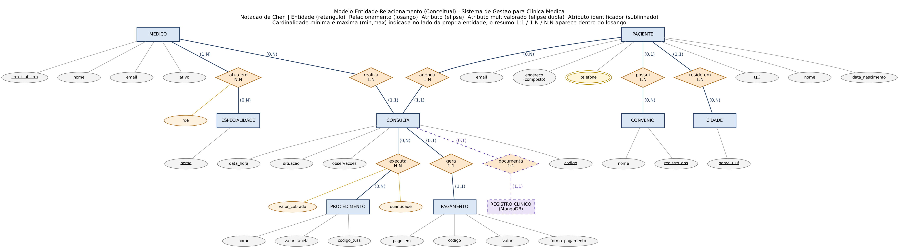

# Parte 1 — Modelo Entidade-Relacionamento (Conceitual)

Modelo conceitual do Sistema de Gestão para Clínica Médica, construído sobre o escopo
definido na Semana 14. Nesta etapa não existem tabelas, chaves estrangeiras nem tipos
de dados: existem **entidades**, **atributos** e **relacionamentos**.

> Arquivos do diagrama: [PNG](diagramas/mer-conceitual.png) · [PDF](diagramas/mer-conceitual.pdf) · [fonte .dot](diagramas/mer-conceitual.dot)

---

## 1. Entidades e atributos

| Entidade | Descrição | Atributos | Identificador |
| --- | --- | --- | --- |
| **PACIENTE** | Pessoa atendida pela clínica. | nome, cpf, data_nascimento, email, endereço (composto: logradouro, número, complemento, bairro, cep), telefone (multivalorado) | cpf |
| **MEDICO** | Profissional que realiza o atendimento. | nome, crm, uf_crm, email, ativo | crm + uf_crm |
| **CONSULTA** | Encontro agendado entre um paciente e um médico em data e hora. Entidade central do sistema. | data_hora, situacao, observacoes | código |
| **PAGAMENTO** | Registro financeiro de uma consulta realizada. | valor, forma_pagamento, pago_em | código |
| **PROCEDIMENTO** | Item da tabela de serviços da clínica (consulta, exame, pequeno procedimento). | codigo_tuss, nome, valor_tabela | codigo_tuss |
| **ESPECIALIDADE** | Área de atuação médica reconhecida. | nome | nome |
| **CONVENIO** | Operadora de plano de saúde. | nome, registro_ans, ativo | registro_ans |
| **CIDADE** | Município do endereço do paciente. | nome, uf | nome + uf |
| **REGISTRO CLÍNICO** | Evolução clínica produzida na consulta. Entidade do lado NoSQL do projeto (MongoDB); aparece no diagrama em tracejado porque não é materializada em tabela. | conteúdo variável conforme a especialidade | — |

**Atributos especiais no diagrama**

- `telefone` é **multivalorado** (elipse dupla): o paciente pode ter celular,
  residencial e comercial. É esse atributo que obriga a criação de uma tabela própria
  na 1FN.
- `endereco` é **composto**: desdobra-se em logradouro, número, complemento, bairro e
  CEP no modelo lógico.
- `valor_total` da consulta é **derivado** e por isso **não aparece** como atributo —
  ele é a soma dos procedimentos executados.

---

## 2. Relacionamentos e cardinalidades

| Relacionamento | Entidades | Cardinalidade | Regra de negócio |
| --- | --- | --- | --- |
| **agenda** | PACIENTE — CONSULTA | **1:N** | Um paciente tem zero ou várias consultas; cada consulta pertence a exatamente um paciente. |
| **realiza** | MEDICO — CONSULTA | **1:N** | Um médico realiza várias consultas; cada consulta tem um único médico responsável. |
| **atua em** | MEDICO — ESPECIALIDADE | **N:N** | Um médico pode ter mais de uma especialidade e uma especialidade é exercida por vários médicos. O relacionamento tem atributo próprio: `rqe`. |
| **executa** | CONSULTA — PROCEDIMENTO | **N:N** | Uma consulta executa vários procedimentos e um procedimento é executado em várias consultas. Atributos próprios: `quantidade` e `valor_cobrado`. |
| **gera** | CONSULTA — PAGAMENTO | **1:1** | Uma consulta realizada gera no máximo um pagamento, e nenhum pagamento existe sem consulta. |
| **possui** | PACIENTE — CONVENIO | **1:N** | Um paciente tem no máximo um convênio (pode ser particular); um convênio atende vários pacientes. |
| **reside em** | PACIENTE — CIDADE | **1:N** | Cada paciente reside em uma cidade; uma cidade tem vários pacientes. |
| **documenta** | CONSULTA — REGISTRO CLÍNICO | **1:1** | Cada consulta realizada produz um registro clínico, armazenado no MongoDB e referenciado por `consulta_id`. |

### Notação de cardinalidade usada

O diagrama traz as duas leituras ao mesmo tempo, para não haver ambiguidade:

- **Dentro do losango**: o resumo clássico — `1:1`, `1:N` ou `N:N`.
- **Na ponta de cada linha**: o par `(mínimo, máximo)` da participação **daquela
  entidade** no relacionamento. Por exemplo, em `agenda`, o lado de CONSULTA é `(1,1)`
  — toda consulta tem obrigatoriamente um paciente — e o lado de PACIENTE é `(0,N)` —
  um paciente recém-cadastrado ainda pode não ter consulta nenhuma.

---

## 3. Relacionamentos N:N identificados

A atividade pede atenção especial aos relacionamentos muitos-para-muitos, porque eles
não sobrevivem à transição para o modelo lógico. O modelo tem dois:

| N:N no conceitual | Vira no lógico | PK da tabela associativa |
| --- | --- | --- |
| MEDICO **atua em** ESPECIALIDADE | `medicos_especialidades` | `(medico_id, especialidade_id)` |
| CONSULTA **executa** PROCEDIMENTO | `consultas_procedimentos` | `(consulta_id, procedimento_id)` |

Os atributos que estavam pendurados no losango do relacionamento (`rqe`, `quantidade`,
`valor_cobrado`) migram para a tabela associativa — é exatamente neles que fica claro
por que a tabela precisa existir: esses dados não pertencem a nenhuma das duas
entidades isoladamente.

---

## 4. Do conceitual ao lógico

O passo seguinte está em [`modelo-logico.md`](modelo-logico.md), e as regras de
normalização aplicadas na transição estão detalhadas em
[`normalizacao.md`](normalizacao.md).
