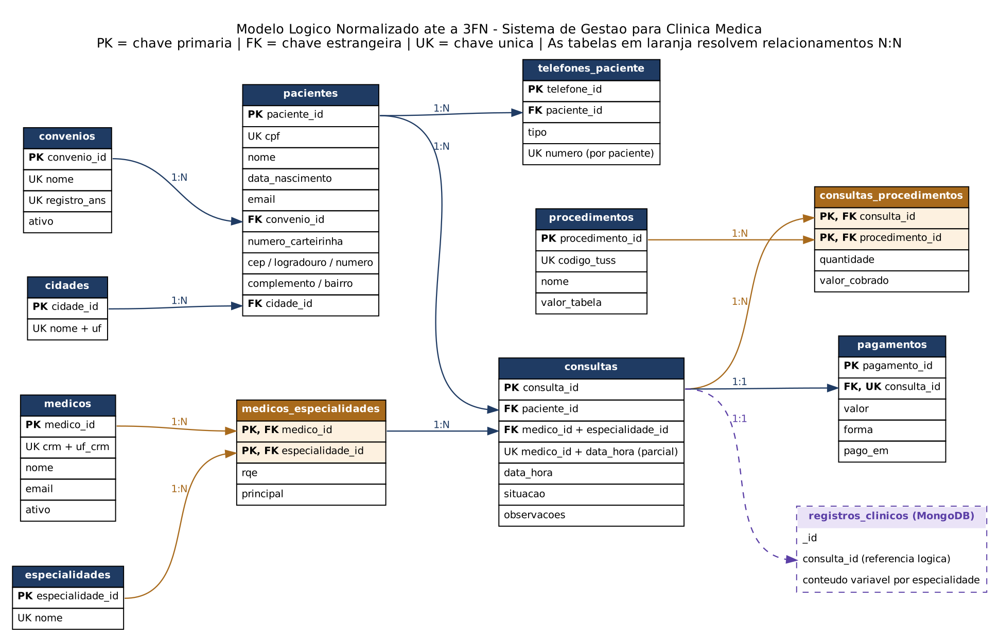

# Parte 2 — Modelo Lógico (tabelas, PKs e FKs)

Transição do modelo conceitual para o modelo lógico, já normalizado até a 3FN. Aqui
não existem mais losangos: relacionamentos viraram chaves estrangeiras e os N:N
viraram tabelas.

> Arquivos do diagrama: [PNG](diagramas/modelo-logico.png) · [PDF](diagramas/modelo-logico.pdf) · [fonte .dot](diagramas/modelo-logico.dot)

---

## 1. Tabelas, chaves primárias e chaves estrangeiras

| Tabela | Chave primária (PK) | Chaves estrangeiras (FK) | Chaves únicas (UK) |
| --- | --- | --- | --- |
| `cidades` | `cidade_id` | — | `(nome, uf)` |
| `convenios` | `convenio_id` | — | `nome`, `registro_ans` |
| `pacientes` | `paciente_id` | `convenio_id` → `convenios` `cidade_id` → `cidades` | `cpf`, `(convenio_id, numero_carteirinha)` |
| `telefones_paciente` | `telefone_id` | `paciente_id` → `pacientes` | `(paciente_id, numero)` |
| `especialidades` | `especialidade_id` | — | `nome` |
| `medicos` | `medico_id` | — | `(crm, uf_crm)` |
| `medicos_especialidades` | `(medico_id, especialidade_id)` | `medico_id` → `medicos` `especialidade_id` → `especialidades` | índice parcial: uma especialidade principal por médico |
| `consultas` | `consulta_id` | `paciente_id` → `pacientes` `(medico_id, especialidade_id)` → `medicos_especialidades` | índice único parcial `(medico_id, data_hora)` para situações ativas |
| `procedimentos` | `procedimento_id` | — | `codigo_tuss` |
| `consultas_procedimentos` | `(consulta_id, procedimento_id)` | `consulta_id` → `consultas` `procedimento_id` → `procedimentos` | — |
| `pagamentos` | `pagamento_id` | `consulta_id` → `consultas` | `consulta_id` (é o que materializa o 1:1) |

---

## 2. Decisões de modelagem

| Decisão | Motivo |
| --- | --- |
| Chave primária **substituta** (`BIGSERIAL`) em vez do CPF ou do CRM como PK | CPF e CRM são chaves candidatas e continuam protegidos por `UNIQUE`, mas um identificador interno curto e imutável é mais barato de referenciar em FK e não quebra se o dado natural precisar ser corrigido. |
| PK **composta** nas tabelas associativas | A junção das duas FKs já identifica a linha e impede, por construção, que o mesmo par seja gravado duas vezes. Um `id` próprio permitiria duplicatas. |
| FK **composta** em `consultas` apontando para `medicos_especialidades` | Garante no banco que o médico só atenda em especialidade que ele realmente possui. Sem ela, a regra ficaria apenas na aplicação. |
| Relacionamento 1:1 feito com FK + `UNIQUE`, e não com PK compartilhada | `pagamentos.consulta_id` é FK e única. Isso mantém a tabela de pagamentos independente e deixa explícito que o pagamento é opcional (só existe depois do atendimento). |
| `ON DELETE RESTRICT` em quase todas as FKs | Dado clínico e financeiro não é apagado em cascata. A exceção é `telefones_paciente`, que usa `CASCADE` por ser dado acessório do próprio paciente. |
| `valor_total` fora das tabelas | Atributo derivado; vive na view `vw_faturamento_consulta`. Ver seção 4 de [`normalizacao.md`](normalizacao.md). |
| `situacao` e `forma_pagamento` como `ENUM` | Domínio fechado e estável, validado pelo banco. |
| `NUMERIC(10,2)` para valores | Precisão exata em dado financeiro; `FLOAT` acumula erro de arredondamento. |

---

## 3. Mapeamento conceitual → lógico

| No modelo conceitual | No modelo lógico |
| --- | --- |
| Entidade PACIENTE | Tabela `pacientes` |
| Atributo multivalorado `telefone` | Tabela `telefones_paciente` (1FN) |
| Atributo composto `endereco` | Colunas `cep`, `logradouro`, `numero`, `complemento`, `bairro` + FK `cidade_id` |
| Relacionamento 1:N `agenda` | FK `consultas.paciente_id` |
| Relacionamento 1:N `realiza` | FK `consultas.medico_id` |
| Relacionamento **N:N** `atua em` | **Tabela** `medicos_especialidades` |
| Relacionamento **N:N** `executa` | **Tabela** `consultas_procedimentos` |
| Relacionamento 1:1 `gera` | FK única `pagamentos.consulta_id` |
| Entidade REGISTRO CLÍNICO | Coleção `registros_clinicos` no MongoDB, ligada por `consulta_id` |

---

## 4. Script correspondente

O modelo acima está implementado em [`database/01_ddl.sql`](../database/01_ddl.sql),
com todas as constraints de `PRIMARY KEY`, `FOREIGN KEY`, `UNIQUE` e `CHECK`.
